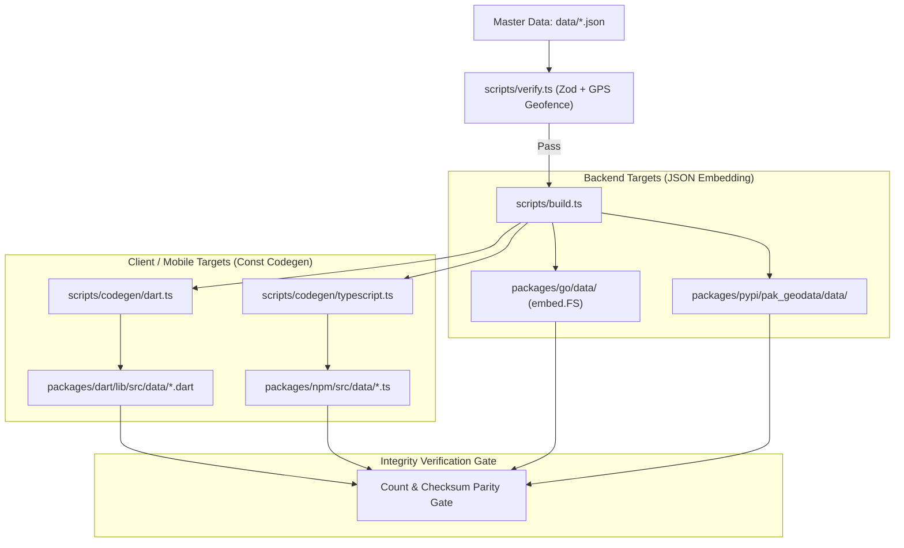

# Multi-Language Architecture & Synchronization Pipeline Design

- **Date**: 2026-11-04
- **Status**: Approved (Brainstorming Complete)
- **Target Release**: Wave 1: Go & Dart/Flutter | Wave 2: PHP (Composer)
- **Authors**: pak-geodata maintainers

---

## 1. Executive Summary & Problem Statement

`pak-geodata` provides verified, typed, and offline geospatial data for all 7 provinces/territories, 79 verified cities, and 3,953 verified urban areas in Pakistan with zero runtime dependencies.

Currently, `pak-geodata` is distributed for:
- **TypeScript / JavaScript** (`packages/npm` on NPM)
- **Python** (`packages/pypi` on PyPI)

Developers building production systems in Pakistan frequently work across backends (Go microservices, Laravel/PHP applications) and cross-platform mobile apps (Flutter / Dart for delivery, fintech, and banking applications).

This specification defines the multi-language monorepo architecture and automated synchronization pipeline to support **Go** and **Dart/Flutter** in Wave 1 (followed by **PHP** in Wave 2) without risking data divergence, maintenance overhead, or platform-specific packaging issues.

---

## 2. Core Principles & Non-Goals

### 2.1 Core Principles
1. **Single Source of Truth**: The master dataset in `data/` (`provinces.json`, `cities/*.json`, `areas/*.json`) is the only place where geodata is curated. No language package ever edits or stores hand-maintained data.
2. **Zero Runtime Dependencies**: Every language client package must rely solely on that language's standard library (pure Go, pure Dart, pure Python, pure TypeScript). Zero external runtime dependencies.
3. **Automated Downstream Sync**: Data synchronization is fully automated via `scripts/build.ts`. Adding an area or fixing coordinates in `data/` updates all language targets identically in a single build pass.
4. **Sub-millisecond Offline Lookups**: In-memory lookups, postal code indexing, Urdu normalization, and spherical Haversine calculations must execute locally in $< 1\text{ ms}$.
5. **No Native Compilation Friction**: No C/C++ bindings, platform-specific wheels, or architecture-specific binary builds.

### 2.2 Non-Goals
- Supporting heavy binary languages (C/C++) with complex platform compilation matrix.
- Network-based geocoding APIs (this package remains strictly offline-first).
- Splitting the codebase across multiple isolated Git repositories (single monorepo remains the source of truth).

---

## 3. Repository Directory Structure

```
pak-geodata/
├── data/                                 # 🌟 Master Dataset (Single Source of Truth)
│   ├── provinces.json                    # 7 Provinces / Territories
│   ├── cities/                           # 79 verified cities
│   └── areas/                            # 3,953 verified areas across all cities
├── scripts/
│   ├── build.ts                          # Master orchestrator: validates, syncs JSON, generates TS & Dart
│   ├── verify.ts                         # Zod schema & GPS geofence validator
│   └── codegen/
│       ├── typescript.ts                 # TypeScript data & subpath generator
│       └── dart.ts                       # Pure Dart const collection generator
├── packages/
│   ├── npm/                              # TypeScript / Node / Bun / Deno / Browser
│   │   ├── src/data/                     # Auto-generated .ts data modules
│   │   └── package.json
│   ├── pypi/                             # Python 3.9+
│   │   ├── pak_geodata/data/             # Synchronized raw JSON data
│   │   └── pyproject.toml
│   ├── go/                               # Go 1.20+ (New)
│   │   ├── data/                         # Synchronized raw JSON data (//go:embed)
│   │   ├── pakgeodata.go                 # In-memory indexes & lookup functions
│   │   ├── geo.go                        # Haversine distance & nearest neighbor
│   │   ├── search.go                     # Urdu normalization, alias & prefix search
│   │   ├── models.go                     # Struct definitions (Province, City, Area)
│   │   ├── go.mod                        # module github.com/sohaibbinmohsin/pak-geodata/packages/go
│   │   └── pakgeodata_test.go            # Parity unit tests
│   ├── dart/                             # Dart 3.x / Flutter (New)
│   │   ├── lib/
│   │   │   ├── src/data/                 # Auto-generated const Dart models
│   │   │   │   ├── provinces.dart
│   │   │   │   ├── cities.dart
│   │   │   │   └── areas.dart
│   │   │   ├── src/
│   │   │   │   ├── geo.dart              # Haversine & spatial lookup
│   │   │   │   ├── search.dart           # Search & Urdu normalization
│   │   │   │   └── models.dart           # Immutable data classes
│   │   │   └── pak_geodata.dart          # Public library export
│   │   ├── pubspec.yaml                  # Pure Dart package manifest
│   │   └── test/
│   │       └── pak_geodata_test.dart     # Parity unit tests
│   └── php/                              # PHP 8.1+ (Wave 2)
│       ├── data/
│       ├── src/
│       └── composer.json
├── tests/
│   └── parity/                           # Cross-language golden test vectors
└── package.json                          # Monorepo root scripts & test runner
```

---

## 4. Master Data Pipeline & Synchronization (`scripts/build.ts`)

Data flows strictly in one direction from `data/` through verification down to language packages:



### 4.1 Verification Gate
Every build execution begins with `verifyAllData()`. It verifies:
- All coordinates lie strictly inside Pakistan bounding box (`23.5 <= lat <= 37.1`, `60.8 <= lng <= 77.8`).
- 5-digit postal codes match official Pakistan Post format.
- Canonical slugs are lowercase alphanumeric hyphenated.
- No duplicate IDs exist across provinces, cities, or areas.

### 4.2 Hybrid Representation Rationale
- **Backend Languages (Go, Python, PHP)**: Raw synchronized JSON files. Go utilizes `//go:embed data/*.json`, bundling the files directly into the compiled Go binary. Zero runtime file lookups or network calls.
- **Frontend / Mobile Languages (TypeScript, Dart)**: Code generation into immutable `const` data arrays. This provides instant app startup in Flutter and web applications with 0 runtime JSON parsing latency and full tree-shaking support.

### 4.3 Parity Check
After compilation, `scripts/build.ts` asserts:
$$\text{count}(\text{provinces}) = 7$$
$$\text{count}(\text{cities}) = 79$$
$$\text{count}(\text{areas}) = 3,953$$
If any generated dataset deviates, the build process aborts with exit code 1.

---

## 5. Standardized Cross-Language API Contract

Every package exposes an identical set of core operations matching idiomatic naming conventions:

| Operation | TypeScript (`npm`) | Python (`pypi`) | Go (`packages/go`) | Dart (`packages/dart`) |
| :--- | :--- | :--- | :--- | :--- |
| **All Provinces** | `getAllProvinces()` | `get_all_provinces()` | `GetAllProvinces()` | `getAllProvinces()` |
| **Province by ID** | `getProvinceById(id)` | `get_province_by_id(id)` | `GetProvinceByID(id)` | `getProvinceById(id)` |
| **All Cities** | `getAllCities()` | `get_all_cities()` | `GetAllCities()` | `getAllCities()` |
| **City by ID** | `getCityById(id)` | `get_city_by_id(id)` | `GetCityByID(id)` | `getCityById(id)` |
| **Cities in Province** | `getCitiesByProvince(id)`| `get_cities_by_province(id)` | `GetCitiesByProvince(id)` | `getCitiesByProvince(id)` |
| **All Areas** | `getAllAreas()` | `get_all_areas()` | `GetAllAreas()` | `getAllAreas()` |
| **Areas in City** | `getAreasByCity(cityId)` | `get_areas_by_city(city_id)` | `GetAreasByCity(cityId)` | `getAreasByCity(cityId)` |
| **Postal Code (Primary)** | `findAreaByPostalCode(code)` | `find_area_by_postal_code(code)` | `FindAreaByPostalCode(code)` | `findAreaByPostalCode(code)` |
| **Postal Code (All)** | `findAreasByPostalCode(code)` | `find_areas_by_postal_code(code)` | `FindAreasByPostalCode(code)` | `findAreasByPostalCode(code)` |
| **Haversine Distance** | `haversineDistanceKm(c1, c2)` | `haversine_distance_km(c1, c2)` | `HaversineDistanceKm(c1, c2)` | `haversineDistanceKm(c1, c2)` |
| **Nearest Area** | `getNearestArea(coords, opts)` | `get_nearest_area(coords, opts)` | `GetNearestArea(coords, opts)` | `getNearestArea(coords, opts)` |
| **Search Areas** | `searchAreas(query, opts)` | `search_areas(query, opts)` | `SearchAreas(query, opts)` | `searchAreas(query, opts)` |

---

## 6. Urdu Normalization & Search Consistency

All language implementations must apply equivalent normalization logic:
1. **Letter Normalization**:
   - Alef variations (`آ`, `أ`, `إ`, `ٱ`) $\rightarrow$ `ا`
   - Yeh variations (`ي`, `ى`, `ئ`, `ے`) $\rightarrow$ `ی`
   - Kaf variations (`ك`) $\rightarrow$ `ک`
   - Heh variations (`ة`, `ھ`, `ہ`) $\rightarrow$ `ہ`
2. **Diacritics Stripping**:
   - Strip Tashkeel (`َ`, `ِ`, `ُ`, `ً`, `ٍ`, `ٌ`, `ّ`, `ْ`, `ٓ`).
3. **Eastern Arabic Digit Conversion**:
   - Convert `۰-۹` and `٠-٩` to standard Western Arabic numerals `0-9`.
4. **Search Ranking**:
   - Exact match $\rightarrow$ Prefix match $\rightarrow$ Native Urdu script match $\rightarrow$ Colloquial alias match (`isb`, `lhe`, `khi`, `pindi`) $\rightarrow$ Token containment / Levenshtein.

---

## 7. Golden Parity Test Suite

A JSON test vector file `tests/parity/golden_vectors.json` will be shared across all test runners to guarantee identical outputs:

1. **Postal Code Resolution**:
   - `"54000"` $\rightarrow$ `lahore-gpo`
   - `"44000"` $\rightarrow$ `islamabad-gpo`
   - `"74200"` $\rightarrow$ `karachi-gpo`
2. **Reverse Geocoding Coordinates**:
   - `[31.4697, 74.4133]` $\rightarrow$ `lahore-dha-phase-5` ($\text{distance} < 0.1\text{ km}$)
   - `[33.7297, 73.0747]` $\rightarrow$ `islamabad-f-6` ($\text{distance} < 0.2\text{ km}$)
3. **Urdu Query Search**:
   - `"گلبرگ"` $\rightarrow$ Top match contains `lahore-gulberg`
   - `"ڈی ایچ اے"` $\rightarrow$ Top matches contain DHA sectors
4. **Colloquial Aliases**:
   - `"isb"` $\rightarrow$ Resolves to Islamabad areas
   - `"pindi"` $\rightarrow$ Resolves to Rawalpindi areas
   - `"khi"` $\rightarrow$ Resolves to Karachi areas

---

## 8. CI/CD Matrix & Publishing

### 8.1 GitHub Actions Workflow Matrix
`.github/workflows/ci.yml` will test all targets on every push and pull request:
- **Node.js**: v20, v22 (builds, lint, npm tests, demo app)
- **Python**: 3.9, 3.10, 3.11, 3.12 (unittest discovery)
- **Go**: 1.21, 1.22 (`cd packages/go && go test -v ./...`)
- **Dart**: 3.x (`cd packages/dart && dart test`)

### 8.2 Versioning & Release Coordination
All packages follow synchronized SemVer:
- **NPM**: Published to `npmjs.com/package/pak-geodata`
- **PyPI**: Published to `pypi.org/project/pak-geodata`
- **Go**: Consumed directly from Git via tag `packages/go/vX.Y.Z` (`go get github.com/sohaibbinmohsin/pak-geodata/packages/go@vX.Y.Z`)
- **Dart**: Published to `pub.dev/packages/pak_geodata` via automated GitHub Action

---

## 9. Implementation Roadmap

- **Phase 1: Build Pipeline & Codegen Modularization**
  - Extract TypeScript generator into `scripts/codegen/typescript.ts`.
  - Add Go master data synchronization in `scripts/build.ts`.
  - Add `scripts/codegen/dart.ts` to generate Dart const collections.
  - Implement count and parity validation checks in `scripts/build.ts`.

- **Phase 2: Go Package (`packages/go`)**
  - Create `go.mod`, models, embedded data loader (`//go:embed`).
  - Implement in-memory indexes, lookups, Haversine spatial math, and search.
  - Implement Go unit tests matching the golden test suite.

- **Phase 3: Dart Package (`packages/dart`)**
  - Create `pubspec.yaml`, immutable const models, lookups, Haversine, and search.
  - Implement Dart unit tests matching the golden test suite.

- **Phase 4: Root Test Scripts & CI Matrix**
  - Update root `package.json` with `test:go`, `test:dart`, `test:all`.
  - Update `.github/workflows/ci.yml` with the polyglot matrix.
  - Document installation and usage for all languages in root `README.md`.
